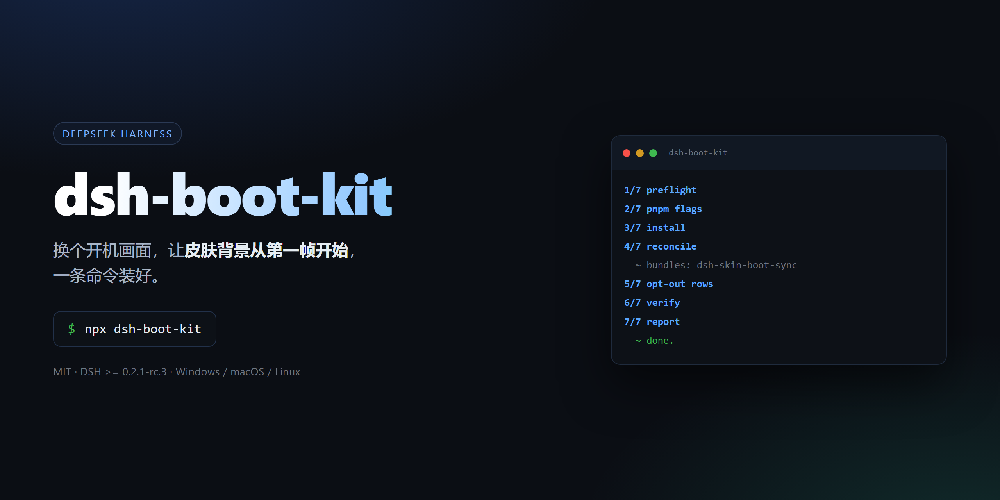
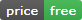
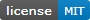
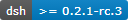
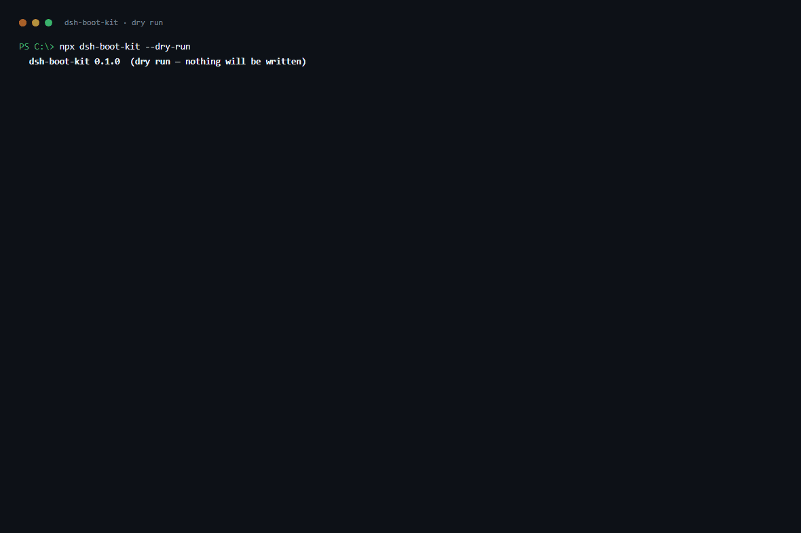

# dsh-boot-kit



[](https://github.com/MrKgg3250/dsh-boot-kit/actions/workflows/ci.yml)
[](https://github.com/MrKgg3250/dsh-boot-kit)
[](LICENSE)
[](docs/compatibility.md)

把「启动动画 + 皮肤背景从头播 + 关掉右下角宠物/余额挂件」这套 DSH 启动体验，
做成一条命令装好。**免费、MIT、无遥测。**

> One command to install a DSH startup animation, make the skin backdrop start on
> its first frame when the curtain lifts, and switch off the floating pet and
> balance widget.



> 一次真实的 `--dry-run`。逐步说明见 [docs/install.md](docs/install.md)。

---

## 快速开始

### Windows：双击安装（不需要会用终端）

把**整个仓库文件夹**拷到目标机器（`install.cmd` 和 `local\` 必须在一起），双击
`install.cmd`，按提示选：

- **Q**（推荐）：启动动画 + 皮肤同步 —— **完全本地，不联网**
- **T**：全套，含主题全家桶（`@linxin666/dsh-web-all`）和关掉右下角宠物 ——
  主题来自 npm，需要能访问 registry（国内配 npmmirror 镜像即可）
- **S**：只装皮肤同步（已经有启动动画的话）

装完**完全退出 DeepSeek Harness Desktop，再重新打开**。

脚本自动找 DSH —— 会从正在运行的桌面端进程反推安装目录，所以没有全局 `dsh`
命令也能装。web / desktop 两个 profile 都会自动检测。

> ⚠️ **如果你之前从 Release 下载过 `install.cmd`，删掉换用仓库里这份**：旧版把包名
> 装成了 GitHub URL，之后每次安装都会去请求 github.com（网络一抖就卡在重试里）。
> 新版全程走本地文件，并且会**自动清理**旧版留下的网络依赖 —— 旧机器双击一次即自愈。

装之前请先把桌面端**完全退出**（desktop profile 的 `package.json` 由桌面端进程锁管理）。

### macOS / Linux / 想自己敲命令

终端在哪里：

- **macOS**：访达 → 应用程序 → 实用工具 → **终端**
- **Windows**：开始菜单搜 **PowerShell**（命令一样能用）

装之前**完全退出 DeepSeek Harness**：

```bash
dsh plugin --profile desktop add \
  https://github.com/MrKgg3250/dsh-boot-kit/releases/download/v1.0.0/dsh-skin-boot-sync-1.0.0.tgz
```

`dsh` 不在 PATH 时用完整路径 `<安装目录>\resources\runtime\cli\bin\dsh.cmd`；
`desktop` profile 要求桌面端至少打开过一次，刚装好应用的机器先启动一次再装。

### 全套安装（启动动画 + 皮肤同步 + 关掉宠物/挂件）

```bash
git clone https://github.com/MrKgg3250/dsh-boot-kit.git
cd dsh-boot-kit

node packages/dsh-boot-kit/bin.mjs --dry-run     # 先看计划，不写任何文件
node packages/dsh-boot-kit/bin.mjs --tier full   # 装
```

档位与 npm 的关系：

| 档位 | 需要 npm 通道？ |
|---|---|
| `--tier minimal` | **不需要** —— 插件来自 GitHub Release |
| `--tier boot` | **不需要** —— 启动动画同样来自 Release |
| `--tier full` | 只有 `@linxin666/dsh-web-all` 需要（国内配 npmmirror 镜像即可） |

> ⚠️ **不要**把仓库地址粘进插件管理页的「从 GitHub 安装」：这是个 monorepo，按仓库名
> 装只会装进 monorepo 根（实测 DSH 提示 `declares no dsh.bundle — installed as a
> plain dependency`，等于装了个空壳，什么都不发生）。

### 关于 npm

本项目**不发布到 npm**（作者所在地区无法访问 npm 发布通道），分发全部走
GitHub Release。`npx dsh-boot-kit` 永远不会工作，别按其他插件的习惯去试。
发布方式与给贡献者的说明见 [docs/publish.md](docs/publish.md)。

---

## 三个档位

| 档位 | 装什么 | 适合 |
|---|---|---|
| `--tier minimal` | `dsh-skin-boot-sync` | 已有自己的启动动画/皮肤 |
| `--tier boot` | + `dsh-startup-screen@1.2.0` | 要启动动画 + 皮肤同步 |
| `--tier full`（默认） | + `@linxin666/dsh-web-all`，并关掉 `web-ui-pet` | 开箱即用 |

`full` **不会**安装 `dsh-whale-widget`（那个右下角余额挂件）。想要就加
`--with-widget`，它会装但保持关闭。

---

## 它到底改了什么

1. `pnpm-workspace.yaml` 里加 `strictDepBuilds: false`
2. 往 profile 装上面那些包
3. **把装好但没登记的包补进 `dsh.profile.bundles`**
4. 在 `cordis.patch.yml` 追加 `- id: web-ui-pet` / `disabled: true` 之类的行
5. 校验：每个计划内的包都登记了、能解析、patch 文件在、没有重复的 loader id
6. 每次改动前备份原文件（`*.bak-<时间戳>`）

第 3 步和第 5 步是这套东西存在的理由，理由写在
[docs/pitfalls.md](docs/pitfalls.md)。

想撤销：

```bash
npx dsh-boot-kit --revert --dry-run   # 先看计划
npx dsh-boot-kit --revert
```

它按意图反做（删掉本工具登记的行和禁用行、卸载本工具装的包），不还原备份——
备份可能早于你自己的编辑。详见 [docs/install.md](docs/install.md#回滚)。

---

## 为什么不是一个插件

因为**插件没法修自己的安装**。下面每一条都会让「装上了但没生效」，而且插件代码
在那时还没机会运行：

- `dsh-startup-screen` 不在 npm，只有 GitHub Release —— `dependencies` 表达不了
- pnpm 11 默认 `strictDepBuilds: true`，原生构建脚本未批准时安装直接非 0 退出
- `dsh plugin` 只在「pnpm 退出 0 且本次新增了依赖」时回写 `bundles`
- desktop profile 由 Electron 托管，CLI 连 `--dump-config` 都被拒绝

所以是「运行时小插件 + 安装器」的组合，而不是一个包。

---

## 仓库结构

```
install.cmd             Windows 一键安装（双击即可，自动找 DSH、自动装）
local/                  随工具分发的安装包（插件 + 启动动画的 tgz），安装全程离线
packages/
  dsh-skin-boot-sync/   运行时插件：揭幕时把皮肤背景视频拨回第一帧（5.7 KB，零依赖）
  dsh-boot-kit/         安装器 CLI：七步流水线 + 校验 + 回滚备份（在线分发用）
docs/
  install.md            安装图解（含 GIF）
  pitfalls.md           四个坑的复盘（含实测证据）
  compatibility.md      版本矩阵与非官方契约
  publish.md            发布到 npm 的清单与命令
  market-listing.md     收录进市场目录的条目与 PR 正文
  upstream-skin-center.md  给上游的提案：让皮肤背景在揭幕时从头播
  media/                封面、徽章、截图，全部由 tools/ 下的脚本生成
tools/
  make-brand.py         生成封面 PNG 与自托管徽章 SVG（需要 Edge/Chrome）
  make-docs-media.py    从真实输出重生成安装截图/GIF（需要 Edge/Chrome + Pillow）
```

## 开发

```bash
# 全部测试（node --test 默认发现，别传目录——见 docs/pitfalls.md）
node --test

# 单个包
node --test "packages/dsh-skin-boot-sync/test/*.test.mjs"
node --test "packages/dsh-boot-kit/test/*.test.mjs"

# 用本仓库的插件源码装（不依赖 npm 发布）
node packages/dsh-boot-kit/bin.mjs --source local --repo-root . --dry-run
```

文档配图不要手改，改完 CLI 输出后重跑：

```bash
python tools/make-brand.py
python tools/make-docs-media.py --input transcript.txt
```

## 许可

MIT。仓库不含任何第三方代码或皮肤素材，第三方组件与许可见 [NOTICE](NOTICE)。

**皮肤不随本仓库分发**：请自行在 DSH 皮肤中心安装（例如 `whale-fantasy`，
其许可为 CC BY-NC-SA 4.0，不可镜像或再分发）。
